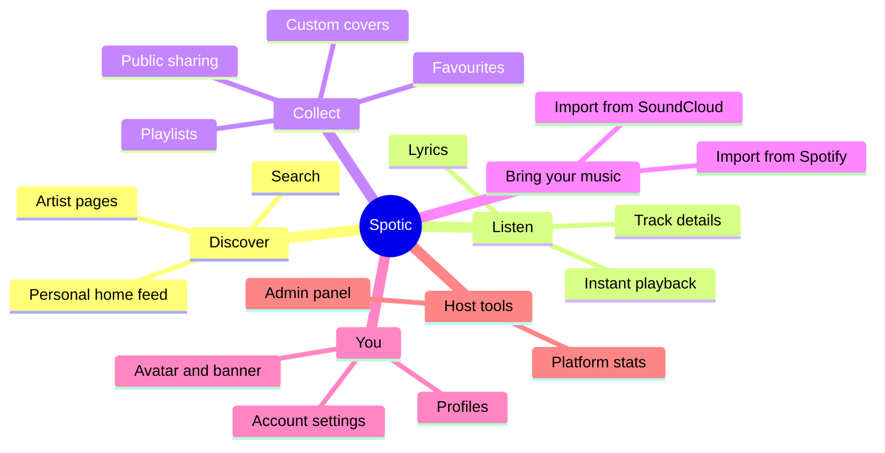
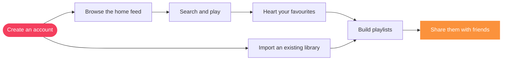

 

*A music app built around the things you love to do: search, play, collect and share.*

---

> **A showcase repository.** It contains no source code, only a tour of what Spotic is and the experience it creates.

## The idea

Music is personal, and the place you keep it should be too. Spotic is a streaming-style music app with a lively home feed, instant search, artist pages, synced lyrics and playlists you can shape, personalize and share, plus simple imports so your existing collection can come along for the ride.

## The shape of the app

## From first listen to your own library

## Features

### Discover and listen

| | Feature | What it feels like |
|---|---|---|
| 🏠 | **Home feed** | A lively front page that gets more personal when you sign in |
| 🔎 | **Search** | Find tracks, artists and playlists in a flash |
| 🎤 | **Artist pages** | Dive into an artist's catalog |
| ▶️ | **Instant playback** | Hit play and the music starts |
| 📝 | **Synced lyrics** | Sing along with lyrics shown right in the player |
| 🏷️ | **Rich track details** | Clean metadata for every track |

### Your library

| | Feature | What it feels like |
|---|---|---|
| ❤️ | **Favourites** | Keep the songs you love one tap away |
| 📚 | **Playlists** | Create, edit and organize as many as you like |
| 🖼️ | **Custom covers** | Give every playlist its own look |
| 🌍 | **Public sharing** | Share playlists and browse other people's |
| 📥 | **Spotify and SoundCloud import** | Bring an existing collection across |

### Profiles

| | Feature | What it feels like |
|---|---|---|
| 🧑‍🎤 | **Public profiles** | Show off your taste with a profile and public playlists |
| 🎭 | **Avatar and banner** | Make your page your own |
| ⚙️ | **Account settings** | Update your details and password any time |

### For the host

| | Feature | What it feels like |
|---|---|---|
| 🛡️ | **Admin panel** | A protected control room for the person running the service |
| 👥 | **User management** | Review accounts and look after the community |
| 🎛️ | **Playlist moderation** | Tidy up playlists and covers when needed |
| 📊 | **Platform stats and settings** | See how things are going and tune the experience |

## Built with

Node.js and Express on the back end, Prisma for data, and a rich metadata and lyrics layer behind the music.

---

**Spotic** · crafted by [Zenix Developers](https://github.com/Zenix-Developers) · [zenix.sg](https://zenix.sg)

*The source code is private. Interested in a closer look? Get in touch.*

